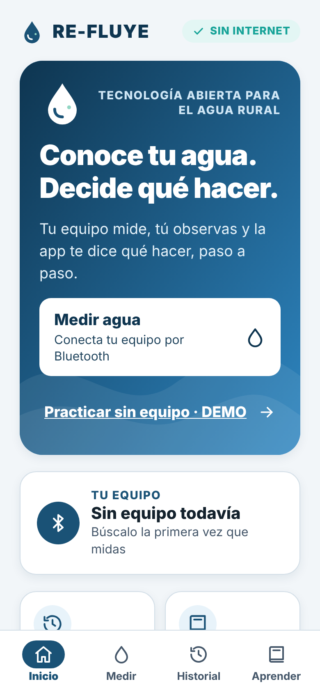
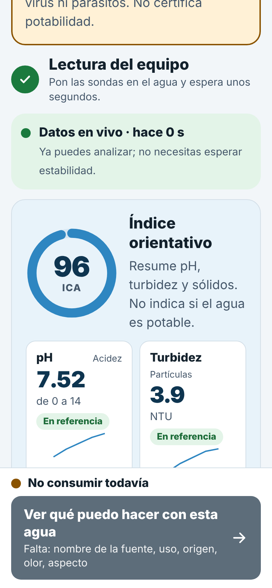
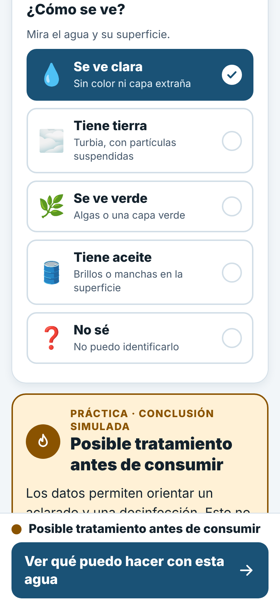
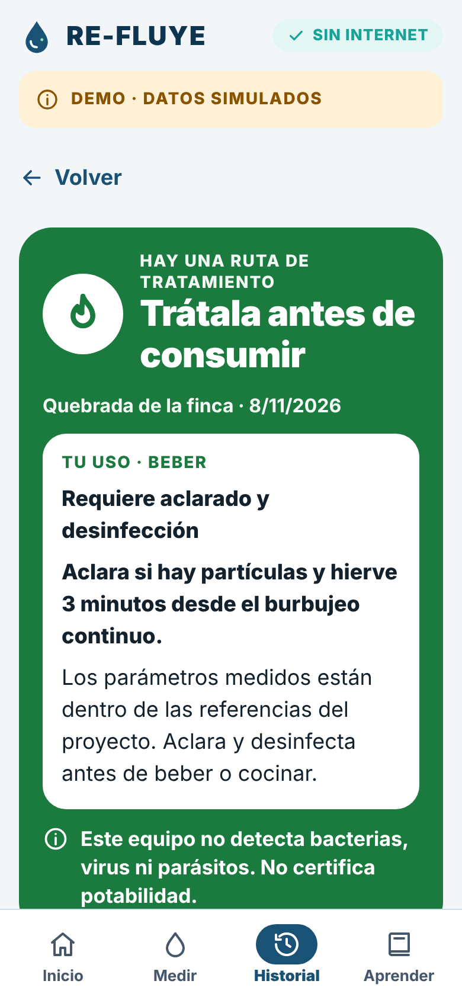
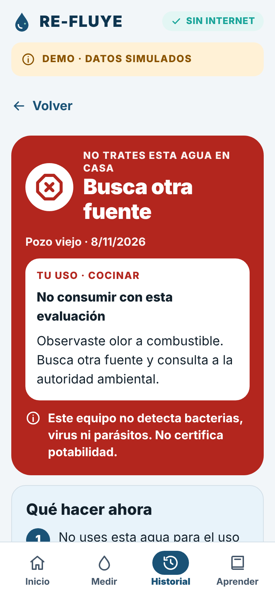
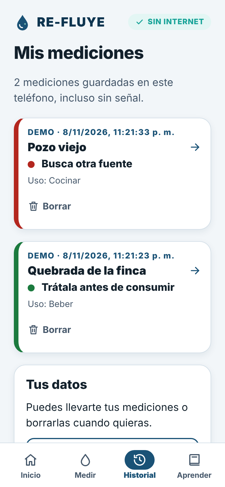

# RE-FLUYE

**Donde el agua no llega, RE-FLUYE.**

RE-FLUYE es un equipo de bajo costo con sensores y una app Android, de código
abierto, que ayuda a familias rurales de Colombia a entender el agua que usan y
qué hacer con ella. Funciona **sin internet**.

> ⚠️ **RE-FLUYE orienta, no certifica.** Mide pH, turbidez, sólidos disueltos y
> temperatura. **No detecta bacterias, virus ni parásitos**, que son la causa
> principal de las enfermedades por agua. Por eso nunca dice que un agua es
> potable, y para beber o cocinar siempre pide desinfectar. No reemplaza un
> análisis de laboratorio.

<p align="center">
  <a href="https://github.com/tomasmanuelgp/CampusMind/releases/latest"><b>⬇️ Descargar la app para Android</b></a>
  ·
  <a href="https://re-fluye.vercel.app/">Sitio del proyecto</a>
  ·
  <a href="docs/hardware.md">Construye tu equipo</a>
</p>

<p align="center">
  
  
  
</p>
<p align="center">
  
  
  
</p>

<p align="center"><sub>RE-FLUYE 1.0 en modo DEMO (datos simulados).</sub></p>

## El problema

En Colombia, **3,2 millones de personas** no tienen acceso a agua potable;
2,6 millones viven en zonas rurales (MinVivienda, 2023). Muchas familias
toman el agua de quebradas, pozos o tanques y no tienen forma de saber si les
puede hacer daño. Un análisis de laboratorio completo de **una sola muestra**
cuesta $1.204.399 (Cornare, 2022), tarda días y describe el agua de un solo día.

RE-FLUYE no reemplaza ese análisis: lo **complementa** con una alerta de todos
los días, por una fracción del costo.

## Cómo funciona

```
 1. MIDE                       2. INTERPRETA                    3. ACTÚA
 Las sondas leen pH,           La app cruza los sensores        Te dice qué hacer:
 turbidez, sólidos y           con lo que tú ves y hueles,      aclarar y desinfectar,
 temperatura. Tú cuentas       sin internet, con reglas         volver a medir o
 de dónde viene el agua,       fijas y revisables.              buscar otra fuente.
 cómo huele y cómo se ve.
```

- **Tu observación cuenta tanto como los sensores.** Un olor extraño detiene
  todo, sin importar los números. Un agua verdosa nunca se resuelve solo
  hirviendo.
- **El resultado depende del uso.** No es lo mismo beber que lavar ropa o dar
  de beber al ganado.
- **Las decisiones las toman reglas fijas**, no una inteligencia artificial,
  para que cualquiera pueda revisarlas. Ver [el motor de reglas](docs/motor-de-reglas.md).

## Qué hay en este repositorio

| Carpeta | Contenido | Licencia |
|---|---|---|
| [`mobile/`](mobile/) | App Android (React Native + Expo + TypeScript + SQLite) | AGPL-3.0 |
| [`firmware/`](firmware/) | Código del ESP32 (Arduino) | CC BY-NC-SA 4.0 |
| [`docs/`](docs/) | Guías, arquitectura, datos, protocolo y manuales | CC BY-NC-SA 4.0 |

Documentación principal:

- [Arquitectura](docs/arquitectura.md): cómo se conectan las piezas, con diagramas.
- [Hardware](docs/hardware.md): componentes, costos y cómo conectar el ESP32.
- [Protocolo Bluetooth](docs/protocolo-bluetooth.md): cómo se hablan el equipo y la app.
- [Motor de reglas](docs/motor-de-reglas.md): cómo decide la app, regla por regla.
- [Datos](docs/datos.md): qué se guarda, dónde y el diccionario de datos.
- [Índice completo de la documentación](docs/README.md).

## Construye tu RE-FLUYE

El núcleo electrónico cuesta entre **$322.319 y $394.319 COP** (precios de
noviembre de 2026):

| Componente | Costo (COP) |
|---|---|
| ESP32 DevKit de 38 pines | 27.000 – 39.500 |
| Kit de pH DFRobot SEN0161 | 178.500 – 238.000 |
| Sensor de turbidez SEN0189 | 45.344 |
| Sensor de sólidos disueltos SEN0244 | 61.575 |
| Sonda de temperatura DS18B20 | 9.900 |

Además: resistencias, LED, pantalla LCD, protoboards, cables, carcasa y
soluciones para calibrar el pH. Lista completa en
[`docs/materiales.csv`](docs/materiales.csv).

### Conectar el ESP32 en 5 pasos

1. **Arma los divisores de voltaje.** Los sensores dan hasta 5 V y el ESP32
   solo aguanta 3,3 V: cada señal pasa por 10 kΩ (sensor → pin) y 20 kΩ
   (pin → tierra).
2. **Conecta los sensores** a estos pines:

   | Sensor | Pin del ESP32 |
   |---|---|
   | pH | GPIO 34 |
   | Turbidez | GPIO 35 |
   | Sólidos disueltos | GPIO 32 |
   | Temperatura (DS18B20) | GPIO 4, con 4,7 kΩ a 3,3 V |
   | Pantalla LCD (I2C) | SDA 21 · SCL 22 |
   | LED verde · amarillo · rojo | GPIO 26 · 25 · 33 (220 Ω cada uno) |

3. **Carga el firmware** [`firmware/refluye_v2/refluye_v2.ino`](firmware/refluye_v2/refluye_v2.ino)
   con Arduino IDE (paquete ESP32 de Espressif 2.0.17 y las librerías
   LiquidCrystal I2C, OneWire y DallasTemperature).
4. **Comprueba el Bluetooth.** El equipo aparece como **ReFluye-V2** (PIN
   **1234**) y envía una lectura cada 1,5 segundos.
5. **Calibra el pH** con soluciones buffer de 4,0 y 7,0 y registra la
   calibración en la app (**Mi equipo**).

La guía completa, con diagramas y problemas comunes, está en
[docs/hardware.md](docs/hardware.md).

## Instalar la app

### En un teléfono Android

1. Descarga la APK de la
   [**última publicación**](https://github.com/tomasmanuelgp/CampusMind/releases/latest)
   (sección *Assets*, archivo `refluye-1.0.0-….apk`). Requiere Android 7.0 o
   superior con Bluetooth Classic. La app no funciona en iPhone por ahora.
2. Ábrela desde **Archivos** o **Descargas**. Si Android lo pide, permite
   instalar apps de esa fuente.
3. Toca **Instalar** y luego **Abrir**. Si tienes una versión anterior,
   instala encima sin desinstalar para conservar tus mediciones.
4. Para practicar sin equipo: **Medir agua → Practicar sin equipo · DEMO**.
5. Para medir de verdad: enciende el equipo, activa Bluetooth, toca **Buscar
   equipos cercanos**, acepta el permiso y elige **ReFluye-V2**.

> Cada APK se compila en GitHub a partir de este código y se publica con su
> suma SHA-256. Si su nombre termina en `pruebas-firma-desarrollo`, es una
> versión de pruebas. Instala solo el archivo publicado allí, nunca una copia
> reenviada. Ver [SECURITY.md](SECURITY.md#apk-oficial) y el
> [registro de cambios](CHANGELOG.md).

### En el computador (para desarrollar)

Necesitas [Git](https://git-scm.com/) y [Node.js 22](https://nodejs.org/).

```sh
git clone https://github.com/tomasmanuelgp/CampusMind.git
cd CampusMind/mobile
npm ci
npm run web
```

Abre la dirección que muestra la terminal y elige **Medir agua → Practicar sin
equipo · DEMO**. El navegador muestra la app con datos simulados; para
conectar un equipo real hace falta la APK de Android. Cómo compilar la APK:
[mobile/README.md](mobile/README.md).

Para comprobar que todo está bien:

```sh
npm run typecheck
npm run lint
npm run test:coverage
```

## Reglas que el proyecto nunca rompe

1. Ninguna pantalla dice «potable», «apta» o «segura» a secas.
2. Toda recomendación para beber o cocinar incluye desinfección.
3. El resultado lo calcula el motor de reglas, nunca una inteligencia artificial.
4. Un olor extraño detiene todo y nada lo anula.
5. El agua verdosa nunca se resuelve solo hirviendo.
6. Cada resultado recuerda que el equipo no detecta microbios.
7. Sin calibración vigente, el resultado se marca como no confiable.
8. La ubicación solo se usa con consentimiento explícito y revocable (hoy la
   app no la recoge).

Varias de estas reglas tienen pruebas automáticas que se ejecutan en cada
cambio.

## Tus datos

Las mediciones se guardan **solo en tu teléfono**. La app no recoge tu
ubicación ni tu nombre. Puedes exportar o borrar tus mediciones cuando quieras
desde **Mis mediciones**. Detalle en [docs/datos.md](docs/datos.md).

## Contribuir

¿Encontraste un error, un paso confuso al construir o una idea? Lee
[CONTRIBUTING.md](CONTRIBUTING.md). Para problemas de seguridad, usa el canal
privado de [SECURITY.md](SECURITY.md). Este proyecto sigue un
[código de conducta](CODE_OF_CONDUCT.md).

## Créditos

- **Proyecto original:** Re-Fluye, de **Alfredo Antonio Díaz Claros**, Centro
  de Competencias Digitales (CCD) de la Universidad Autónoma de Bucaramanga
  (UNAB): [adiacla/refluye](https://github.com/adiacla/refluye). El firmware,
  el diseño del hardware y la fórmula del índice derivan de su trabajo.
- **Esta versión:** Semillero InnovaMinds, Colegio Técnico Industrial José
  Elías Puyana, Floridablanca (Santander).

## Licencia

- App (`mobile/`), scripts y CI: [AGPL-3.0](LICENSE).
- Firmware (`firmware/`) y documentación (`docs/`):
  [CC BY-NC-SA 4.0](docs/LICENSE), por derivar del proyecto original.
- La marca RE-FLUYE no está incluida en estas licencias.

Detalle y forma de dar crédito en [LICENCIAS.md](LICENCIAS.md).
