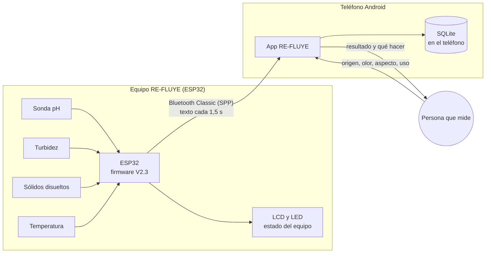
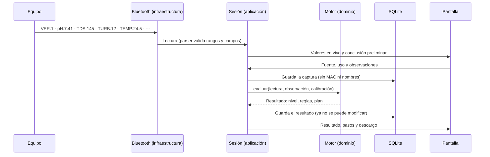
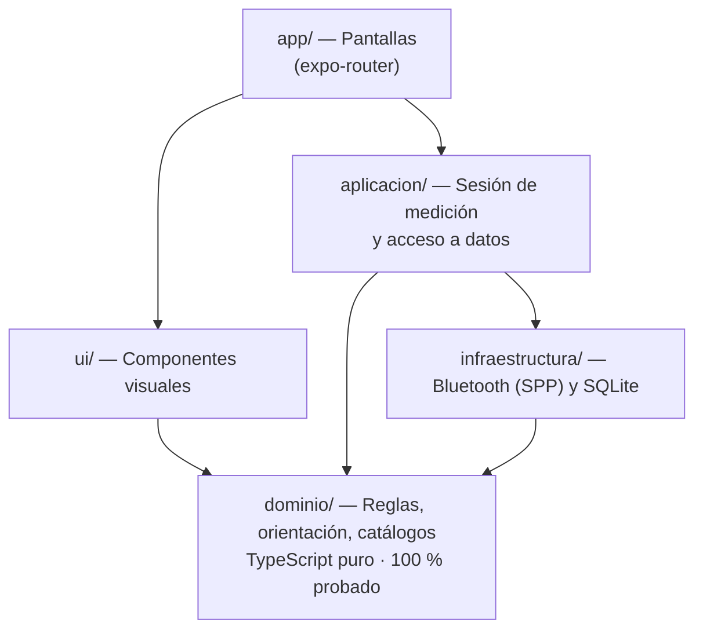

# Arquitectura de RE-FLUYE

RE-FLUYE tiene dos partes que se hablan por Bluetooth: un **equipo** con
sensores (ESP32) y una **app Android**. Todo lo necesario para medir y decidir
funciona **sin internet**.

## Vista general

| Parte | Hace | No hace |
|---|---|---|
| **Equipo** | Mide y transmite una trama de texto cada 1,5 s | No decide si el agua sirve; no recibe comandos |
| **App** | Combina sensores y observación, decide con reglas fijas, guía el tratamiento y guarda el historial | No usa internet en la ruta de medición; no detecta microbios |

## El recorrido de una medición

## Capas de la app

El código de la app (`mobile/src/`) está separado en capas. Cada capa solo
puede usar las que están debajo de ella.

| Carpeta | Contiene | Regla |
|---|---|---|
| `dominio/` | `motor.ts` (reglas), `orientacion.ts` (qué hacer según el uso), `resumenEnVivo.ts`, `catalogos.ts`, `estabilidad.ts`, `monitoreo.ts`, `calibracion.ts`, `privacidad.ts` | **Sin React, sin red, sin archivos.** Funciones deterministas. 100 % de cobertura obligatoria |
| `aplicacion/` | `sesion.ts` (estado de la medición, reconexión, DEMO), `almacen.ts` (datos para las pantallas) | Une dominio e infraestructura |
| `infraestructura/bluetooth/` | `servicio.ts` (Android), `parser.ts` (protocolo) | Habla con el equipo |
| `infraestructura/db/` | `esquema.ts`, `repositorio.ts` (SQLite), `repositorio.web.ts` (DEMO en navegador) | Guarda en el teléfono |
| `app/` | Una pantalla por archivo: `index`, `conectar`, `medir`, `resultado`, `protocolo`, `historial`, `datos`, `equipo`, `aprender`, `observacion` | Muestra; no decide |
| `ui/` | `componentes.tsx`, `opciones.tsx`, `sensores.tsx`, `conclusion.tsx` | Botones ≥ 64 px, alto contraste, lectura en voz alta |

Los archivos `*.web.ts` reemplazan al de Android cuando la app corre en el
navegador: allí solo existe el modo DEMO, porque los navegadores no hablan
Bluetooth Classic.

## Decisiones de diseño

| Decisión | Por qué |
|---|---|
| **Bluetooth Classic, no BLE** | Es lo que el ESP32 ya emite. Evita el corte de mensajes de BLE. Consecuencia: no hay versión web conectada ni iPhone por ahora |
| **Texto `CLAVE:valor`, no JSON** | Si se pierde una línea, las demás siguen sirviendo, y se puede leer en cualquier terminal serie. Ver [protocolo-bluetooth.md](protocolo-bluetooth.md) |
| **El equipo no decide** | El veredicto necesita lo que el equipo no ve: olor, color y origen del agua |
| **Reglas fijas, no IA** | Una decisión de salud debe poder auditarse. Ver [motor-de-reglas.md](motor-de-reglas.md) |
| **Todo en el teléfono (SQLite)** | En el campo no hay señal. Además, los datos no salen del teléfono. Ver [datos.md](datos.md) |
| **Expo con *development build*** | El módulo Bluetooth es nativo: no funciona en Expo Go |

## Lo que todavía no existe

El diseño contempla un **modo conectado opcional**, aún no implementado:

- **Supabase** (Postgres, autenticación) para sincronizar mediciones con
  consentimiento, con políticas RLS en todas las tablas y solo la clave
  pública (`anon`) en la app. Ver [app/11-datos-y-backend.md](app/11-datos-y-backend.md).
- **Una capa de IA** detrás de una Edge Function que **explica** el resultado
  del motor sin poder cambiarlo. La clave del proveedor vive solo en el
  servidor. Ver [app/10-capa-ia.md](app/10-capa-ia.md).

Nada de esto será necesario para medir: la ruta crítica seguirá siendo offline.

## Herramientas

| Herramienta | Uso |
|---|---|
| React Native 0.86 + Expo SDK 57 + expo-router | App |
| TypeScript estricto | Tipos |
| Zustand | Estado de la sesión |
| expo-sqlite | Base de datos local |
| react-native-bluetooth-classic | Puerto serie Bluetooth |
| Vitest | Pruebas (con SQLite real de Node) |
| ESLint + Prettier | Estilo |
| Arduino (núcleo ESP32 2.0.17) | Firmware |
| GitHub Actions | Pruebas, firmware, enlaces y secretos en cada cambio |
