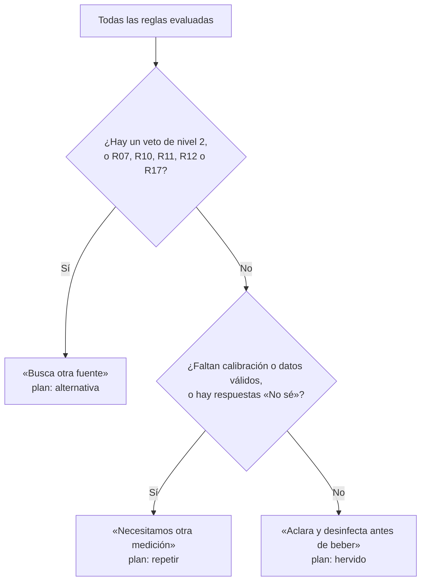

# El motor de reglas: cómo decide RE-FLUYE

El motor es la parte de la app que **decide** qué decirle a una persona sobre su
agua. Está en [`mobile/src/dominio/motor.ts`](../mobile/src/dominio/motor.ts):
unas 60 líneas de TypeScript puro, sin internet, sin inteligencia artificial y
sin azar. Con los mismos datos, siempre da la misma respuesta.

## Por qué reglas y no inteligencia artificial

Una decisión sobre el agua que bebe una familia tiene que poder **revisarse
línea por línea**. Las reglas se leen, se prueban y se discuten. Por eso:

- **El motor decide; la IA, si algún día se usa, solo explica** (regla S3). Una
  IA nunca puede contradecir, ablandar ni reinterpretar el resultado del motor.
- Cada regla tiene un código (R01, R02…) que aparece en «Ver detalles técnicos».
- Cada regla tiene pruebas automáticas, y todo `mobile/src/dominio/` exige
  100 % de cobertura.

## Qué entra al motor

| Entrada | De dónde viene | Ejemplo |
|---|---|---|
| **Lectura** | El equipo, por Bluetooth | pH 7,41 · turbidez 12 NTU · sólidos 145 ppm · 24,5 °C |
| **Observación** | La persona que mide | Origen: corre · Olor: normal · Aspecto: clara |
| **Calibración** | Registrada en «Mi equipo» | Vigente hasta 2027-05-01 |
| **Estabilidad** | Las últimas 4 lecturas | Estable o inicial |

Las sondas no ven lo que tú ves. Por eso la observación pesa tanto como los
sensores, y a veces más: un olor extraño detiene todo sin importar los números.

## Las reglas

El motor revisa **todas** las reglas y luego elige como motivo principal la
primera que se cumpla, en este orden. Los vetos van antes que las advertencias.

### Vetos: nivel 2 («Busca otra fuente»)

| Código | Se activa si… | Por qué |
|---|---|---|
| R01 | El olor es a **combustible** | Hidrocarburos: hervir no los quita y puede concentrarlos |
| R02 | El olor es **extraño** (cualquiera) | Un olor raro indica contaminación que el equipo no mide. **Nada lo anula** (S4) |
| R03 | Hay una **capa aceitosa** | Hervir o filtrar con tela no elimina aceites |
| R06 | Agua **verdosa y quieta** | Posibles toxinas de algas que **no se eliminan hirviendo** (S5) |
| R04 | pH menor que 5,5 o mayor que 9,5 | Valor extremo: posible contaminación química |
| R08 | Turbidez de 100 NTU o más | Demasiadas partículas para tratar en casa |
| R09 | Sólidos disueltos de 1500 ppm o más | Muchas sales: hervir no las quita |

### Advertencias: nivel 1

| Código | Se activa si… |
|---|---|
| R17 | Sólidos disueltos **por encima de 1000 ppm**: fuera del rango validado del sensor SEN0244. La lectura deja de ser confiable |
| R05 | La lectura **no es confiable**: sin calibración vigente, con errores, de un protocolo desconocido, sólidos fuera del rango validado o todavía inicial (variable) |
| R07 | El agua es **verdosa** (aunque corra): nunca se resuelve solo hirviendo |
| R10 | pH fuera de 6,5 – 8,5 (rango de referencia para consumo humano) |
| R11 | Turbidez de 25 NTU o más |
| R12 | Sólidos disueltos de 600 ppm o más |
| R13 | El agua está **quieta** (estancada): favorece microbios |
| R14 | Alguna observación es «No sé» |
| R16 | El agua se ve **turbia** |

### Sin alertas: nivel 0

| Código | Se activa si… | Qué dice |
|---|---|---|
| R15 | Ninguna de las anteriores | «Los parámetros medidos están dentro de las referencias del proyecto. Aclara y desinfecta antes de beber o cocinar.» |

Incluso con R15 la app **nunca** dice que el agua es potable: pide aclarar y
desinfectar (S2), porque el equipo no ve microbios.

## Del resultado al plan

Después de las reglas, el motor elige uno de tres planes:



| Plan | Qué ve la persona |
|---|---|
| **alternativa** | No uses esta agua para lo que elegiste; busca otra fuente y pide una revisión |
| **repetir** | No decidas con esta lectura; revisa la calibración y vuelve a medir |
| **hervido** | Aclara si hay partículas, hierve 3 minutos desde el burbujeo fuerte, guarda tapada |

Si la lectura es **inicial** (aún varía), el plan de hervido se muestra como
«Posible tratamiento; verifica primero» y el resultado queda marcado como no
confiable.

## Orientación por uso

El mismo resultado se traduce según el uso que eligió la persona
([`orientacion.ts`](../mobile/src/dominio/orientacion.ts)):

- **Beber, cocinar, lavar utensilios:** si el plan es hervido, muestra los pasos
  de aclarado y hervido.
- **Bañarse, lavar ropa, ganado, cultivos:** la app **no confirma** estos usos
  con los sensores; remite a orientación local o técnica. Nunca los autoriza.

## El ICA orientativo

La app muestra un número de 0 a 100 que resume pH, turbidez y sólidos disueltos:

```
ICA = 0,4 × max(0, 100 − |pH − 7,4| × 30)
    + 0,3 × (100 − turbidez / 2)
    + 0,3 × (100 − sólidos / 20)
```

- Si un sensor está fuera de rango (pH fuera de 0–14, turbidez fuera de 0–200,
  sólidos fuera de 0–2000), el ICA no se calcula.
- La temperatura no entra: aún no hay un peso validado para ella.
- **El ICA no decide nada.** Un ICA de 100 con olor extraño sigue siendo «Busca
  otra fuente». No es un porcentaje de potabilidad.
- La ponderación (40/30/30) viene del firmware del proyecto original de Alfredo
  Antonio Díaz Claros (CCD-UNAB).

## Cómo se prueba

| Prueba | Archivo | Qué garantiza |
|---|---|---|
| Casos golden | [`__tests__/casos-golden.json`](../mobile/src/dominio/__tests__/casos-golden.json) | Cada regla, con su entrada y su resultado esperado |
| Combinaciones | `motor.test.ts` | Miles de combinaciones de lecturas y observaciones respetan los vetos |
| Invariantes S1–S7 | `invariantes.test.ts` | Ningún texto dice «potable» sin negación; beber siempre exige desinfección; el olor extraño siempre veta |

Para cambiar una regla: agrega primero su caso golden, luego cambia el código y
explica en el *pull request* qué cambia para la persona que mide. Ver
[CONTRIBUTING.md](../CONTRIBUTING.md#cambios-en-el-motor-de-reglas).

## Límites conocidos

- La calibración es **declarada**: el motor confía en lo que se registró en «Mi equipo».
- El sensor de sólidos solo está validado hasta 1000 ppm. Desde el motor 0.4.0
  (2026-11-08), toda lectura por encima de ese valor activa R17, se marca como
  no confiable y lleva a buscar otra fuente.
- Un equipo sin línea `VER` (firmware antiguo) se acepta como confiable si todo
  lo demás está en orden (decisión del equipo, 2026-11-08).
